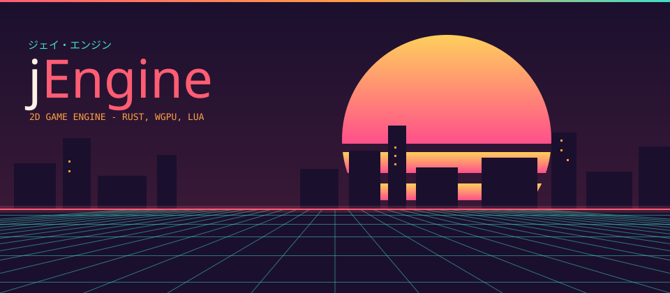
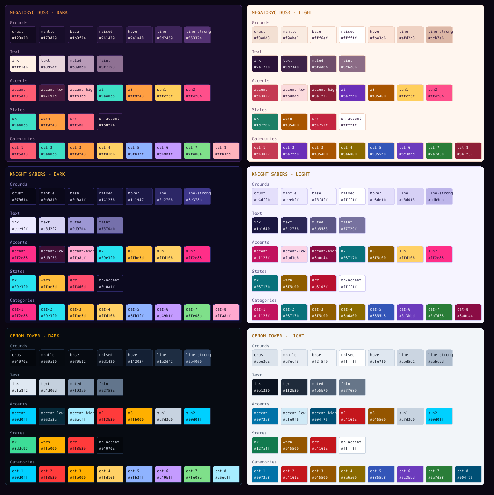
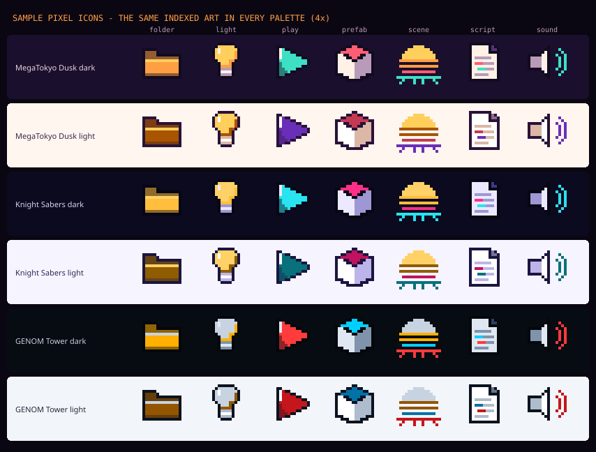
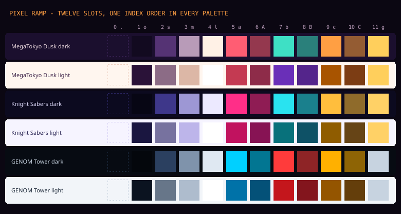

# jEngine visual style guide

How jEngine looks - the editor, the website, and anything else that carries the
name: banners, slides, social cards, store pages, icon sets, splash screens.
Make new material by these rules and it will sit beside the editor and the site
as one family.



**Where the values live.** The palettes are code, and this guide is generated
from that code where it can be:

| What | Source of truth |
|---|---|
| Editor colours (`--ed-*`) | [`editor/src/theme.css`](../../editor/src/theme.css) |
| Website colours (`--jx-*`) | [`website/src/styles/palettes.css`](../../website/src/styles/palettes.css) |
| Every token as data, the pixel ramps | [`tokens.json`](tokens.json) - generated |
| Pixel palettes for Aseprite / GIMP | [`palettes/*.gpl`](palettes/) - generated |
| The boards in this guide | [`img/`](img/) - generated |

`python docs/brand/build_brand.py` regenerates everything in `docs/brand`
except this README and the icon sources. It also **fails if the editor and the
website disagree** on a shared colour. Run it after touching either palette
file. Never hand-edit a generated file; change `theme.css` and rebuild.

---

## 1. The idea

**A late-80s / early-90s anime title card at dusk.** The look comes from OVA
cyberpunk (*MegaTokyo* evenings, *Bubblegum Crisis*, the *GENOM* tower): a
night city in silhouette, a striped sun setting into a neon grid, and hot
accent colours over deep, slightly purple darks.

Three rules carry most of the look:

1. **Dark, coloured grounds, never grey or black.** Every dark has a hue
   (plum, night blue, steel blue). Pure `#000` and neutral greys are off-brand.
2. **Neon used sparingly.** On any one surface there is one accent doing the
   talking. The second and third accents are supporting voices, not equals.
3. **Flat shapes, crisp edges, one glow.** Colour is flat, and anything round
   or soft is drawn rather than blurred. The only glows are neon and the sun: the
   horizon line, a primary button on hover, the wordmark's "Engine", the sun's
   halo.

---

## 2. Palettes

Three palettes, each with a dark and a light set. **MegaTokyo Dusk dark is the
default and the brand's face**: use it for anything that shows one palette
(logos, banners, store art). Material that ships inside the editor or the site
must work in all six.

| Palette | Mood | Accent / second / third |
|---|---|---|
| **MegaTokyo Dusk** (`dusk`) | plum sky, coral neon, setting sun | coral `#ff5d73` / teal `#3ee0c5` / tangerine `#ff9f43` |
| **Knight Sabers** (`sabers`) | night blue, hot pink, cyan | pink `#ff2e88` / cyan `#29e3f0` / amber `#ffbe3d` |
| **GENOM Tower** (`genom`) | blue-black steel, HUD cyan, alarm red | cyan `#00d0ff` / red `#ff3b3b` / amber `#ffb000` |



### What each token is for

| Token | Role | Never |
|---|---|---|
| `crust` | The deepest ground: toolbar, title bars | text |
| `mantle` | Strips and docks: tab bars, side panels, code background | — |
| `base` | The main ground: panel bodies, page background | — |
| `raised` | Things that sit on the ground: inputs, cards, menus | a page background |
| `hover` | A row or button under the pointer | a resting state |
| `line` | Every 1 px border and divider | text |
| `line-strong` | Borders of floating things (menus, dialogs), dashed outlines | — |
| `ink` | Headings, selected text, the wordmark's "j" | long body text in light mode (use `text`) |
| `text` | Body text, values | — |
| `muted` | Labels, secondary text, captions | — |
| `faint` | Hints, placeholders, disabled items, inactive tabs | anything a user must read (it is ~4.2:1) |
| `accent` | **The brand colour.** Selection, the active tab's underline, the primary button, focus of attention | two accent-filled areas side by side |
| `accent-low` | Selection backgrounds, accent tags, hover in menus | text |
| `accent-high` | Text on `accent-low`, bright accent text | large fills |
| `a2` | Second voice: links, play / run, flow, connections, the grid floor | the primary action |
| `a3` | Third voice: eyebrow labels, warm notes, files and folders | errors |
| `ok` / `warn` / `err` | Status only | decoration |
| `on-accent` | Text and icons drawn on `accent`, `ok` and the `cat-*` fills | — |
| `sun1` → `sun2` | The sun's gradient, top to bottom | anything but the sun and light sources |
| `cat-1` … `cat-8` | Telling kinds of thing apart: node categories, data types, chart series | status, emphasis |

The website has the same colours under its own names: `--jx-bg` is `base`,
`--jx-panel` is `raised` (dark sets), `--jx-line` is `line`, and `ink`, `text`,
`muted`, `accent`, `accent-low`, `accent-high`, `a2` and `a3` keep their names.
Its `--jx-n-*` "night" tokens are the dark set, used by the designed pages
whatever theme the docs are in, because the title card is always night.

### Colour rules

- **Contrast.** `text` and `muted` pass WCAG AA on `base` in every set (`text`
  about 13:1, `muted` 6.2–7.3:1). `faint` is about 4.2:1 - fine for hints and
  disabled items, not for anything a user must read. `on-accent` on `accent`
  is at least 5.1:1. `build_brand.py` prints these figures.
- **Status is not brand.** `err` is close to the accent in Dusk, so an error
  always has a second cue: an icon, a label, a tinted row. Never colour alone.
- **Tints are mixes, not opacity.** A tinted surface is
  `color-mix(in srgb, <token> 8–22%, transparent)` (or over `base`). Never
  lower the opacity of text.
- **Light sets are not inverted dark sets.** Accents are darker and more
  saturated in light mode (`#c43a52`, not `#ff5d73`). Take the light token;
  never reuse a dark hex on a light ground.
- **In the engine, colours are linear.** A colour picked here and typed into a
  sprite tint or a `.gui` file comes out washed out. Convert sRGB to linear first.
  See "Colours are linear" in `CLAUDE.md`.

---

## 3. Type

| Face | Use | Never |
|---|---|---|
| **Dela Gothic One** (`--ed-display`) | The wordmark, display headings, the kana line | body text; anything under 14 px; buttons |
| **IBM Plex Sans** 400 / 500 / 600 (`--ed-sans`) | All interface text and prose | — |
| **IBM Plex Mono** 400 / 500 (`--ed-mono`) | Values, paths, code, shortcuts; **uppercase labels** | paragraphs |

All three are OFL and self-hosted from `@fontsource` (the site's CSP allows
fonts from itself only, and the editor runs offline).

**The label style** is the signature small type: IBM Plex Mono, uppercase,
letter-spacing `0.12em` (tabs) to `0.16em` (eyebrows), 10.5–12 px. Panel tabs
are `ink` when active and `faint` when not. Eyebrows above headings are `a3`.

| Editor | Size / weight |
|---|---|
| Body, menus | 12.5 px / 400 |
| Section title | 13.5 px / 600, `ink` |
| Panel tab, eyebrow | Mono 10.5 px / 500, uppercase, +0.12em |
| Values, paths | Mono 11.5 px |
| Wordmark in the toolbar | Dela Gothic One 15 px |
| Start-screen title | Dela Gothic One 56–92 px |

| Website | Size |
|---|---|
| Display (`h-display`) | Dela Gothic One, `clamp(2.9rem, 8.5vw, 6rem)`, line-height 0.95 |
| Section heading | Dela Gothic One, `clamp(1.9rem, 4.4vw, 3rem)` |
| Lede | Plex Sans 1.125 rem, `muted`, max 52ch |
| Body | Plex Sans 1 rem / 1.65 |

UI labels and buttons are sentence case ("Open project", not "Open Project").
Uppercase belongs to the mono label style only.

---

## 4. The marks

### The wordmark

**j**Engine: Dela Gothic One, the lowercase **j** in `ink`, **Engine** in
`accent`. On the title card "Engine" may carry the neon glow
(`text-shadow: 0 0 30px` of the accent at 55%). Never:

- capitalise the j, put a space or a hyphen in it, or set it in another face;
- colour it outside the current palette's `ink` + `accent`;
- fill it with a gradient, outline it, or tilt it;
- set it on a photograph without a dark scrim behind it.

### The striped sun

The mark. A disc with a vertical gradient from `sun1` (top) to `sun2`
(bottom), cut by horizontal gaps that **thicken toward the bottom**: the solid
top half, then bands. The site's banding, as fractions of the diameter (from
`site.css .sun`):

```
solid 0-52%   gap 52-56%   band 56-66%   gap 66-71%   band 71-79%   gap 79-85%   band 85-91%
```

The small marks (toolbar, favicon `website/public/favicon.svg`) use fewer,
proportionally wider gaps, so the stripes survive at 16-32 px. Beside the
wordmark the sun is as tall as the cap height and sits left of it, with a gap
of half its diameter. Below 24 px use the pixel version (`pixel-icons/scene.txt`).

### The kana line

ジェイ・エンジン ("jei enjin") in Dela Gothic One, `a2`, letter-spacing
`0.4em`, above the wordmark. Decoration on title cards only, never in running UI.

### The title card

The composition everything big is built from (the image at the top of this
page; the website's hero, the editor's start screen):

1. **Sky**: a vertical gradient from `base` down to `base` mixed toward the accent
   (about 20%), or a radial accent glow low on one side.
2. **Sun**: right of centre, its lower part behind the city and cut off by the horizon.
3. **City**: flat rectangles of uneven width and height in exactly the `base`
   colour, with a gap where the sun shows. A few lit windows in `a3` (and one
   in `a2`) on the tallest towers, one or two pixels each.
4. **Horizon**: a 1-2 px `accent` line with a soft glow
   (`box-shadow: 0 0 16-22px` accent).
5. **Grid floor**: `a2` lines at about 50%, a perspective grid
   (`perspective(240-420px) rotateX(58-60deg)`), cells about 56 px across.
   On the site it scrolls toward the viewer (1.6 s loop) unless reduced
   motion is set.
6. **Words** bottom-left or top-left over the sky: kana line, wordmark, then an
   eyebrow line in mono `a3`.

At social-card size (1200 x 630) keep the sun at about 45% of the height
and the wordmark at least 120 px tall.

### The rule

A 2 px line under every header bar: `linear-gradient(90deg, accent, a3 55%, a2)`
at 85% opacity. It is the brand's signature at small scale. Use it once
per screen.

---

## 5. Shape, space and depth

- **Radii**: 3 px (tags, chips), 4 px (buttons, inputs, menu rows), 5-6 px
  (cards, panels, segmented controls), 7-8 px (menus, dialogs, call-to-action boxes),
  50% (status dots). No pill-shaped buttons.
- **Borders**: 1 px `line` everywhere; 1 px `line-strong` on floating
  surfaces; dashed `line-strong` for empty drop zones and "add" affordances.
- **Shadows**: only on floating things (menus, dialogs, tooltips):
  `0 14px 34px rgba(0,0,0,.45)`. Cards in the page flow have a border, not a
  shadow. The only glows are the ones in §1.
- **Spacing** on a 2 px / 4 px step: 2, 4, 6, 8, 10, 12, 16, 24, 32, 48, 64.
- **Editor density**: tree rows and inputs 24 px, tabs and buttons 26-30 px,
  the toolbar 40 px. Touch targets on the website are at least 44 px.
- **Segmented controls** sit in a `mantle` well with a 1 px `line` border and
  2 px padding. The chosen segment is `raised` with a 2 px accent underline (or
  filled `ok` for Play).
- **Selection** is `accent-low` behind `ink` text. Never a left-border stripe.

---

## 6. Motion

Short and physical. 100-150 ms ease for colour and position changes. A tile
lifts 2 px on hover, a button presses down 1 px, and the primary button gains
its accent glow on hover. Neon may flicker, rarely (the site's `flicker`: two
dips in seven seconds). Nothing moves under `prefers-reduced-motion`.

---

## 7. Icons

There are two icon families. Pick one per surface and never mix them in one row.

### 7.1 Line icons (UI glyphs)

The editor's toolbar and inline controls: 16 px box, 1.3-1.5 px stroke,
square-ish joins, no fills except small solid glyphs (play triangle, stop
square), drawn in `currentColor` so they take the token of their text. Inline
SVG, `aria-hidden` when there is a label beside them.

### 7.2 Pixel icons

The asset browser, file types, the start screen, anything that wants
character. Every rule here exists so that **one indexed image works in all
six palettes**:



**Canvas.** 16 x 16, with a 1 px margin (a 14 x 14 live area). A 32 x 32
variant follows the same rules with a 2 px margin; it is a redraw, not a
2x upscale. Scale only by whole numbers (2x, 3x, 4x) with nearest-neighbour
filtering (`image-rendering: pixelated`).

**Twelve colour slots, in a fixed order.** Draw in the slots, never in hex.
The `.gpl` palettes list them in this order, so an indexed image drawn against
`jengine-dusk-dark.gpl` becomes any other palette by swapping the palette
file. The letters are the ones the text sources in `pixel-icons/` use.

| # | Letter | Slot | Dark sets take | Light sets take |
|---|---|---|---|---|
| 0 | `.` | clear | transparent | transparent |
| 1 | `o` | outline | `crust` | `ink` |
| 2 | `s` | shadow | `line-strong` | `faint` |
| 3 | `m` | mid | `muted` | `line-strong` |
| 4 | `l` | light | `ink` | `raised` (white) |
| 5 | `a` | accent | `accent` | `accent` |
| 6 | `A` | accent shade | accent 45% to outline | accent 35% to outline |
| 7 | `b` | second | `a2` | `a2` |
| 8 | `B` | second shade | a2 45% to outline | a2 35% to outline |
| 9 | `c` | warm | `a3` | `a3` |
| 10 | `C` | warm shade | a3 45% to outline | a3 35% to outline |
| 11 | `g` | glow | `sun1` | `sun1` |



**Drawing rules**

1. **Silhouette first.** Fill every non-clear pixel with one colour: the icon
   must still read. If it does not, no shading will save it.
2. **A closed 1 px outline** (`o`) around every object, with stair-stepped
   diagonals, never doubled. **Light sources have no outline**: the sun, a
   flame, a glow.
3. **Lit from the top-left.** A one-pixel highlight (`l`, or `g` on warm
   things) along the top and left edges; the shade slot along the bottom and
   right. One highlight and one shade per hue, no more.
4. **One hue family per icon**, plus glow. Hue follows meaning, as in the
   editor: `accent` for the things you make (scenes, prefabs, selection),
   `a2` for running and signals (play, audio, links, connections), `a3` for
   files, folders and warm materials, `glow` for light. Neutrals (`m`, `l`)
   carry documents, tools and containers.
5. **Gradients are stripes, not dithering.** The brand shows a gradient as
   bands of slot colours, like the sun (`g` → `c` → `a`). No dithering at
   16 px; at 32 px a checker between two adjacent slots is allowed for one
   transition.
6. **No anti-aliasing, no opacity, no colours outside the slots**, no text
   or letters at 16 px, no drop shadows (the UI adds none).
7. **Optical centring.** A pointing shape (play) sits one pixel toward its
   tail. Round shapes may touch the margin where a square would not.

**Delivering a set**

- Source: an Aseprite file in Indexed mode on `jengine-dusk-dark.gpl`, or a
  text grid like `pixel-icons/*.txt`. `build_brand.py` checks every text grid
  (16 rows of 16 valid letters) and renders it.
- Export: indexed PNG, index 0 transparent, kebab-case names (`prefab.png`).
  One file per icon. The palette variants are produced by swapping the
  palette, not drawn again.
- In the editor, either ship the six palette swaps and pick by
  `data-palette` / `data-theme`, or recolour at load from the
  `themeColors` store (`editor/src/lib/stores/themeColors.ts`), which resolves
  the same tokens the ramp is built from.

**Generating with an image model** (any pixel-art image model will do).
Prompt, then **always quantise**:

```
16x16 pixel art icon of <subject>, game-editor UI icon, centered with 1px
transparent margin, 1px dark outline, lit from the top left, flat shading
with one highlight and one shade, limited palette: #120a20, #553374,
#b89bb8, #fff1e6, #ff5d73, #94384e, #3ee0c5, #2a807b, #ff9f43, #945c33,
#ffcf5c, no anti-aliasing, no dithering, no text, transparent background
```

(Those are the Dusk dark slots 1-11, from `tokens.json` → `pixel_ramps`;
take them from there again if the palette changes.)

Then convert the result to Indexed with `palettes/jengine-dusk-dark.gpl`
(Aseprite: Sprite → Color Mode → Indexed, "Palette" as the source), redraw
anything the quantiser smeared, and check the silhouette rule. A model's
output is a sketch to clean up, not a deliverable. Generate in Dusk dark only;
the other palettes come from the swap.

---

## 8. Pictures

- **Screenshots** come from the engine itself: the native runtime's
  `JENGINE_SHOT` hook (CLAUDE.md, "To see a scene without the editor"), with
  any in-game caption hidden, 16:9 (21:9 for a lead image). Frame them with
  a 6 px radius and a 1 px `line` border. A caption goes over a gradient to
  the ground colour at the bottom, never burned into the image.
- **Illustration** follows the title card: flat silhouettes in the ground
  colour, the palette's accents as light, one glow. No stock photography, no
  3D renders, no generic "tech" gradients (purple-to-blue washes).
- **Diagrams** use `line` strokes, `raised` boxes, mono labels, and the `cat-*`
  hues when boxes need to be told apart.

---

## 9. Writing

Short declarative sentences; say what a thing does, not how good it is. Use
sentence case in the UI and the mono-uppercase label style for eyebrows and
tabs only. The engine is "jEngine" in running text, never "JEngine" or
"j-Engine".

---

## 10. Checklist for new material

- [ ] Uses only tokens from one palette and mode, and Dusk dark if it shows one.
- [ ] One accent leads each surface; status colours carry a second cue.
- [ ] Text is `text` or `muted` on its ground; `faint` only for hints and disabled items.
- [ ] Dela Gothic One only for the wordmark and display sizes; labels in mono uppercase.
- [ ] The wordmark is **j** in ink + **Engine** in accent, unaltered.
- [ ] Flat colour, 1 px borders, shadows only on floating surfaces, one glow.
- [ ] Pixel art: 16 x 16 indexed on the twelve slots, outline, top-left light, swaps cleanly.
- [ ] Generated art was quantised to the slot palette and cleaned by hand.
- [ ] Nothing moves under reduced motion.
- [ ] If a palette value changed: `python docs/brand/build_brand.py` ran clean.
